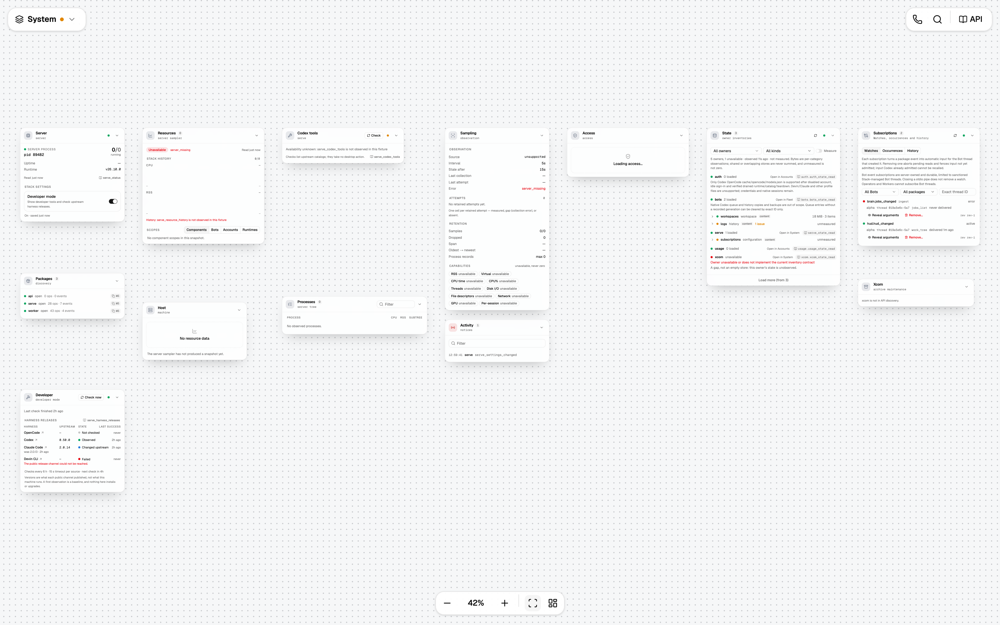
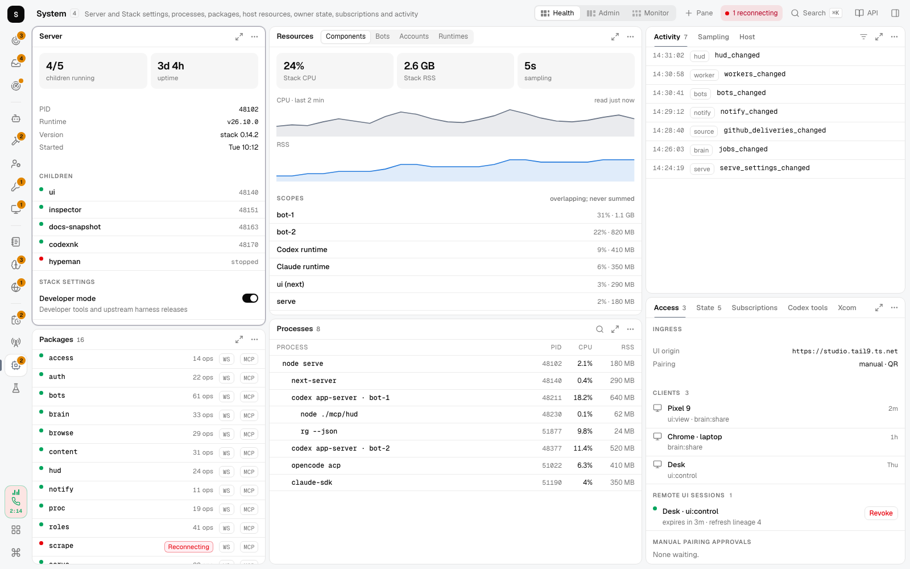
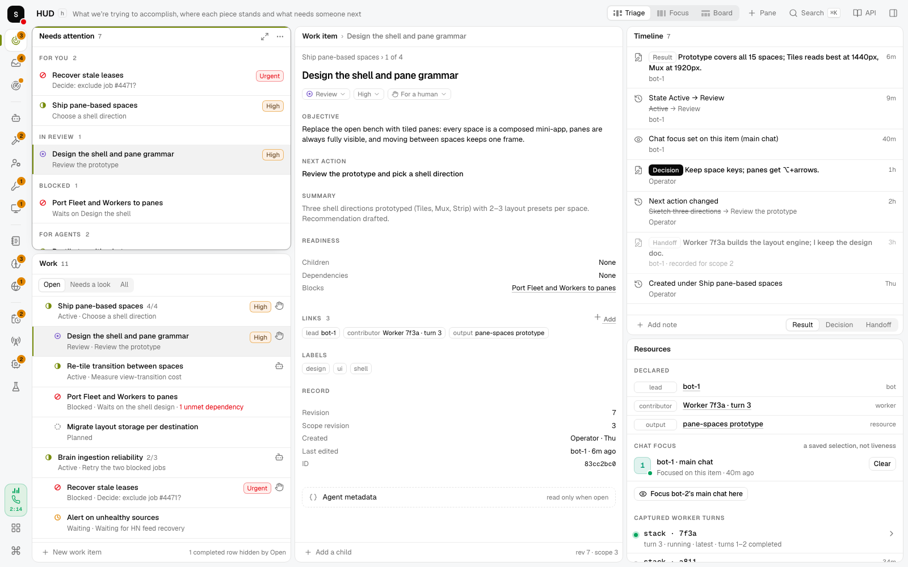
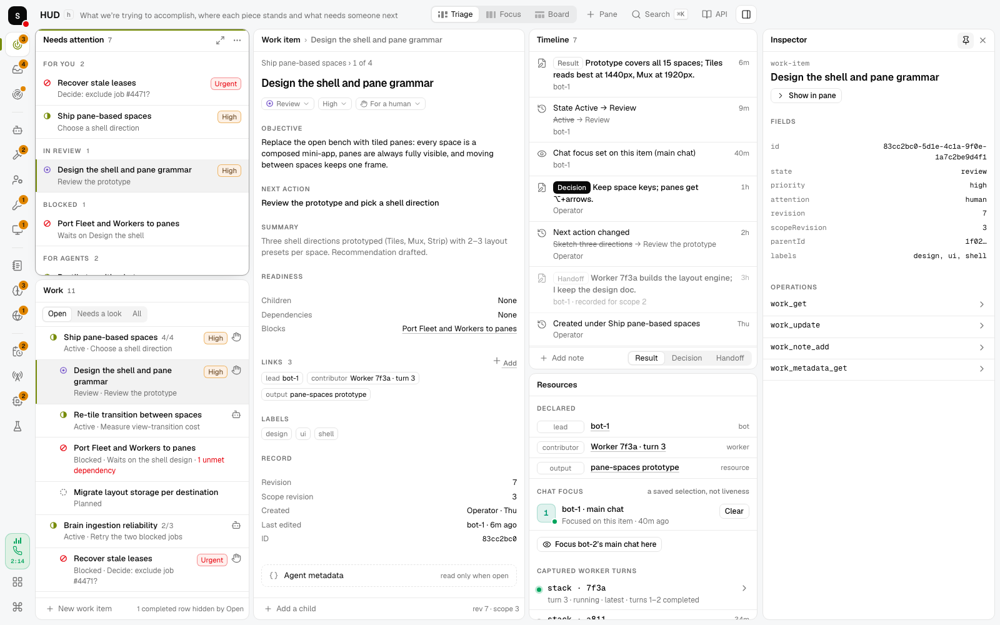
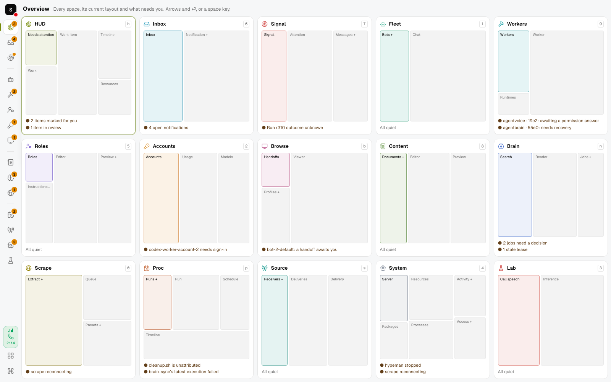
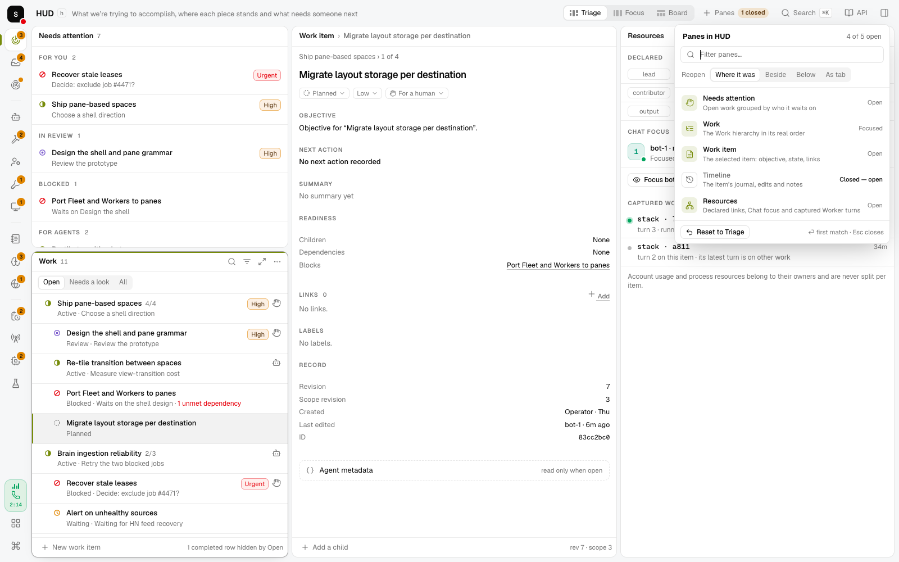

# Pane spaces — design study

Status: proposal for review, 2026-10-11. Throwaway prototype on branch
`worktree/pane-spaces-design`; nothing here is on `main` or touches the live UI.

**Ask:** replace the open bench with spaces that work like a window manager or terminal
multiplexer — every component a pane — so each space is a composed mini-app and the
spaces weave together, without changing what any space can do.

**Recommendation:** shell **A · Tiles**. A rail of places grouped by job, a slim
header per space that names it and offers 2–3 layout *presets*, and tiled panes that
always fit the viewport. It borrows the multiplexer's key model (⌥ + arrows, a ⌃B
leader with hints and pane numbers) and keeps the bench's spatial delight as the
**Overview** — a map of every space — instead of as the place you work.

Run it: `pnpm --filter @stack/ui prototype:panes` (or
`node packages/ui/prototypes/pane-spaces/serve.mjs`) → <http://127.0.0.1:8797/?variant=A>.
The black pill at the bottom switches shells (A/B/C), theme, a simulated call and
per-space design notes. Synthetic data only.

| Today: System at "Fit" (42%) | Proposed: System, Health preset |
| --- | --- |
|  |  |

## Why the bench stopped working

The evidence is in the verification screenshots the UI program already produced:

- **Fit makes things unreadable; 100% clips them.** System fits at 42% zoom
  ([before-system-bench](shots/before-system-bench.png)); Source at 99% cuts every
  window at the viewport edge ([before-source-bench](shots/before-source-bench.png)).
  Windows have content heights and registered widths, so they never match the screen.
- **Geometry is the person's job.** Drag, resize on a 22 px grid, the content-fit
  groove, pushes, tidy, fit, zoom and per-space cameras (ADRs 0070, 0072, 0089, 0173)
  all exist to manage free placement that carries no meaning beyond column order.
- **Navigation moves a camera.** A link pans and flashes a card; context is lost and
  most of every screen is empty dot grid.
- **Chrome floats over work.** The Spaces menu, tools, zoom bar and call island sit on
  top of windows — the call island covers Fleet's Chat header
  ([before-accounts-bench-dark](shots/before-accounts-bench-dark.png)).
- **Loud surfaces.** Glass cards on a dot grid, icon tiles in every header and cards
  inside cards compete with the records.

## Principles

1. **Every pane is fully visible.** The layout sizes panes; nothing is off-screen, zoomed
   or clipped. Panes scroll their own content.
2. **A space is a composed mini-app.** It opens in a curated layout that reads left to
   right — *find → read/act → evidence* — with 1–2 alternates for other jobs.
3. **One frame.** Rail, header, drawer and call never move; only panes re-tile.
4. **Panes answer to their own size.** Container queries let one pane render as a list,
   lanes or two columns depending on where the layout puts it (HUD's Needs attention
   becomes five lanes in the Board preset).
5. **Keyboard and pointer parity.** Everything is reachable both ways; nothing is a
   gesture-only affordance.
6. **Accent marks identity, never state.** Focus and selection are neutral; a space's
   accent is a hairline, a tab underline and a selection bar. A warm accent (Signal,
   Proc, Accounts) must never read as an error.
7. **Say a state once, at its scope.** A closed channel is one chip in the space header,
   not a badge in every pane; a pane's failed read is in that pane's head; a record's
   state is on its row.

## The shell (A · Tiles)

**Rail — places.** Fifteen spaces grouped by job, always in the same place:
*Work* (HUD, Inbox, Signal) · *Agents* (Fleet, Workers, Roles, Accounts, Browse) ·
*Knowledge* (Content, Brain, Scrape) · *Machine* (Proc, Source, System, Lab).
Attention is a count badge (or a dot when a count means nothing) with the existing
`spaceAttention` reasons on hover. The active indicator slides between items. The mark
carries a server-health dot; the foot holds the call chip, Overview and keys. Space
keys are unchanged (`h 1–9 0 b n p s`).

**Space header — identity and arrangement.** Title, key and description; the layout
presets as a segmented control, each with a glyph of its arrangement; **Panes** (the
space's pane catalog, with a "2 closed" count when any are closed); Search ⌘K; API
reference; Inspector. Space-wide
facts appear here once: *Reconnecting · last read 40s ago*, *Remote · view only*
(replacing today's floating banner).

**Pane anatomy.**

- Title row: title · count · › selected record (`Work item › Design the shell…`).
  Clicking the title inspects, as `NodeTitle` does today; dragging it moves the pane.
- Stacked panes show tabs instead of a title (i3's tabbed container). Views (Open ·
  Needs a look · All, the Worker's eight tabs, …) ride in the title row while there is
  room and drop to a view bar when the pane is narrow or tabbed.
- Actions appear on hover or focus: pane actions, zoom, and a pane menu that also holds
  the connection detail the status dot used to carry (*Live · read 2s ago · ws://…*).
- Footers keep the existing creation convention (ADR 0068) plus freshness.
- Focus: a stronger neutral border and a 2 px accent hairline. Selection: neutral tint
  and a 2 px accent bar.

**Drawer — inspector and API reference.** The inspector is the global scratch column
(i3's scratchpad). Unpinned it *floats* over the right edge and contracts on outside
input — today's ADR 0085 behavior — so inspecting never re-tiles the space. Pinned, it
*docks* as a column and the space re-tiles around it. API reference is the drawer's
wide mode and always docks. Both persist across space changes.

**Overview (`o`).** Every space as a live schematic of its current layout, its focused
pane tinted with the space accent, and its attention reasons. Arrows and ⏎ or a space
key. It replaces the Spaces menu's "Show all" and is where the bench's spatial idea
lives on — as a map, not a workplace.

**Palette (⌘K).** Unchanged role, plus pane and layout commands (*Layout: Focus*,
*Zoom focused pane*, *Reopen Timeline*) and records.

**Call.** A rail chip with live levels and elapsed time; mute and hang-up open from it.
It never covers content.

**Narrow (< 900 px).** One pane at a time with pane chips; the space title opens the
Overview as the space picker. ([narrow](shots/a-inbox-narrow.png))

## Layout model

- **A layout is a tree** of splits (row or column, with shares) whose leaves are
  **stacks** of panes. Each existing `WindowDef` becomes a pane kind; window bodies are
  reused as they are.
- **Presets.** Each space declares 2–3 named trees. `[` `]` or the header control
  switches them. Changes the person makes (dock, resize, close, split) persist per space
  in the destination namespace (`uix.layout.v1.<space>`, ADR 0167) until *Reset to
  preset*.
- **Pane verbs.** Focus ⌥ + arrows · swap ⌥⇧ + arrows · zoom `z` · close `x` (with
  undo) · split `\` / `-` (opens the pane catalog set to beside / below) · dock by
  dragging a title onto an edge (split) or the centre (tab) · resize by dragging a gap,
  double-click to even out.
- **The pane catalog** (header **Panes**, `\`, `-`, or ⌘K → *All panes in …*) lists
  every pane the space offers, with a one-line description and where it is:
  *Focused*, *Open*, *Tab behind Bots*, *Behind the zoom* or *Closed*. Choosing an open
  pane brings it forward (its tab, out of a zoom, focused, flashed); choosing a closed
  one reopens it **where it was** — beside the neighbour it had when it closed — or,
  by choice, beside, below or as a tab of the focused pane. A filter narrows the list
  and ⏎ opens the first match. Spaces with multi-record panes add *Pin another to …*
  (a chat per Bot, a Worker, a profile viewer, a run). *Reset to <preset>* restores the
  curated arrangement.
- **Closing never loses anything.** A closed pane leaves the layout, not the space: in
  the real app it stays mounted but hidden (React `Activity`, as hidden benches are
  today), so its drafts, selection and scroll survive a close and reopen. The toast's
  *Undo* restores the exact arrangement; the catalog's *Closed* entries and ⌘K
  *Reopen …* bring panes back later. A space always keeps at least one pane. (The
  prototype restores placement and selection; it has no drafts to keep.)
- **Following and pinned panes.** A detail pane follows its list's selection. ⌘-click a
  row, or *Open a pinned pane beside*, creates a pane that keeps its record — today's
  "additional chat / Worker / viewer / run windows", now splits you can zoom or tile.

- **Links.** A link goes to the record's home pane in its space (re-tiling there),
  activates its tab or reopens it, focuses it and flashes the row. A back chip in the
  header returns to where you came from; browser history keeps working.

## Weaving spaces together

- **One frame**: only the pane area changes when you switch.
- **Re-tile transition**: pane boxes glide from their old rectangles to the new ones
  and contents crossfade (~280 ms; instant under reduced motion). Presets, zoom and
  drawer docking use the same motion, so every rearrangement speaks one language.
- **The rail indicator slides** and the header title crossfades.
- **Hovering a link that leaves the space lights its destination in the rail.**
- **A shared grammar**: lists left, the selected thing in the middle, history and
  evidence right, admin in stacks. Moving between spaces feels like moving between
  rooms built on the same plan.

## Keys

| Keys | Action |
| --- | --- |
| `h 1–9 0 b n p s` | Spaces (unchanged) |
| `o` | Overview |
| ⌘K | Palette |
| ⌥ + arrows · ⌥⇧ + arrows | Focus pane · swap with neighbour |
| `z` · `x` · `\` `-` | Zoom · close · pane catalog to reopen or split right / down |
| `[` `]` | Previous / next layout preset |
| `i` · `Esc` | Inspector · close overlay, restore zoom, leave a text field |
| ⌃B then a key | Leader (works inside text fields): arrows/hjkl, `q` pane numbers, `z`, `%` `"`, `[ ]`, digits, `o` |

Single keys work only when focus is outside a text field, as space keys do today.

## The spaces

Each space below lists its mini-app, its default preset first, and the alternates.
Every current window is present in at least one preset and can be reopened in any.
Screenshots: `shots/a-<space>.png` (default) and `shots/p-<space>-<n>.png`.

| Space | Mini-app | Presets (default first) |
| --- | --- | --- |
| HUD | Project tracker | **Triage**: Needs attention over Work · Work item · Timeline over Resources. **Focus**: Work · wide item · stacked Timeline/Resources/Attention. **Board**: Needs attention full width as five lanes, over Work · item · stack. |
| Inbox | Mail client | **Mail**: Inbox · Notification (Compose behind it; the compose action brings it forward). **Reading pane below**. **Three-up** (today's arrangement). |
| Signal | Inbox with its evidence | **Attention**: Signal · Attention · Messages/Runs/Changes. **Trace**: runs get the width traces need. **Operate**: processing, runs, change log. |
| Fleet | Agent multiplexer | **Chat**: Bots/Bot state · following Chat. **Tiled chats**: several main threads at once. **State**: Bot state's eight views. |
| Workers | Agent console + review | **Follow**: Workers over Runtimes · wide following Worker. **Compare**: two Workers side by side. |
| Roles | IDE | **Editor**: Roles over an explorer stack (Instructions, Skills, MCP servers, Trusted projects) · Editor · Preview/Shims. **Resources**: the three resource lists at once. **Review**: Instructions · Preview. |
| Accounts | Quota dashboard | **Overview**: Accounts · Usage · Models. **Usage**: meters full width over Accounts · Models. |
| Browse | Remote desktop + queue | **Handoff**: Handoffs over Profiles/Controllers/Toolchain · large Viewer. **Watch**: two viewers. **Manage**: no viewer, no stream. |
| Content | Notes app + files | **Write**: sources stack · Editor · Preview. **Library**: Library over Artifacts · Preview. **Read**: Documents · wide Preview. |
| Brain | Search engine + reader | **Research**: Search · Reader · Jobs/Ingest/Sources. **Read**: wide Reader. **Ingestion**: Ingest · Jobs · Sources. |
| Scrape | URL request workbench | **Workbench**: Extract/Feeds/Convert as one tool pane · Queue over Presets/Checks/Status. **Health**: 2 × 2 preset health. |
| Proc | Cron dashboard + logs | **Runs**: Runs/Schedules · wide Run log · Schedule, over a full-width Timeline. **Schedules**: definitions over Timeline. **Logs**: two run logs tiled. |
| Source | Webhook inspector | **Ledger**: Receivers/Catalog · Deliveries · Delivery. **Watches**: watch inbox beside the delivery. **Setup**: Receivers · Event catalog. |
| System | Activity Monitor + settings | **Health**: Server/Packages · Resources/Processes · Activity stack over an admin stack. **Admin**: Access · State · Subscriptions. **Monitor**: six live panes (tmux tiled). |
| Lab | Scratch bench | **Bench**: Call speech · Inference. **Inference**: Inference over Call speech. |

### Pane inventory

Every pane each space offers — exactly the windows `components/canvas/spaces.tsx`
registers today (78 pane kinds), as the pane catalog lists them.

| Space | Panes |
| --- | --- |
| HUD | **Needs attention** — Open work grouped by who it waits on **Work** — The Work hierarchy in its real order **Work item** — The selected item: objective, state, links **Timeline** — The item’s journal, edits and notes **Resources** — Declared links, Chat focus and captured Worker turns |
| Inbox | **Inbox** — Notifications, newest first **Notification** — One notification and its answers **Compose** — Send an operator notification |
| Signal | **Signal** — Processing switch, health and defaults **Attention** — What conversations ask of you **Messages** — Captured messages **Runs** — Interpretation runs and traces **Changes** — The durable change log |
| Fleet | **Bots** — Every Bot with its state and controls **Bot state** — One Bot’s stored state and maintenance **Chat** — A Bot’s main thread, live *Pinned chat panes: one per Bot* |
| Workers | **Workers** — Every Worker, by what needs attention **Runtimes** — ACP and Claude runtimes **Worker** — One Worker’s conversation, changes and settings *Pinned Worker panes: one per Worker* |
| Roles | **Roles** — Named Roles and the default **Instructions** — Categories and Fragments in render order **Skills** — The Role’s skills **MCP servers** — Stack and Role MCP servers **Trusted projects** — Trusted projects **Editor** — Edit the selected record **Preview** — Exact instructions and the launch preview **Shims** — Commands that launch native CLIs under a Role |
| Accounts | **Accounts** — Bot and Worker accounts and sign-in **Usage** — Quota meters and reset times **Models** — Models and efforts each Worker account offers |
| Browse | **Handoffs** — Handoffs waiting for you **Profiles** — Browser profiles by Bot **Controllers** — Controller observations **Toolchain** — agent-browser and Hypeman **Viewer** — A profile’s live browser *Pinned viewer panes: one per profile* |
| Content | **Documents** — Search and list Vault documents **Library** — Collections, items and uploads **Artifacts** — Published Artifacts and versions **Storage** — Uploads, blobs and temporary publications **Editor** — Edit a document or document item **Preview** — The rendered selection and its links |
| Brain | **Search** — Search collected research **Reader** — Read one research document **Jobs** — The ingestion ledger **Ingest** — Submit a URL or text **Sources** — Recurring sources and their runs |
| Scrape | **Extract** — Extract one URL **Feeds** — Discover and parse feeds **Convert** — Convert HTML to Markdown **Queue** — Scrape-to-file jobs **Presets** — Presets and their health **Checks** — Canaries and corpus replay **Status** — Optional tools and egress |
| Proc | **Runs** — Process runs **Schedules** — Schedules, by what needs you **Run** — One run’s command and output **Schedule** — One schedule’s definition and executions **Timeline** — Executions across schedules over time *Pinned run panes: one per run* |
| Source | **Receivers** — Receivers, intake and setup **Event catalog** — GitHub’s event catalog **Deliveries** — The delivery ledger **Delivery** — One delivery and its original payload **Watches** — Watches and their inboxes |
| System | **Server** — Server status, children and Stack settings **Packages** — Package channels and MCP endpoints **Resources** — Stack CPU and memory by scope **Processes** — The observed process tree **Activity** — Recent change notices **Sampling** — Sampling coverage and retention **Host** — Machine identity, memory and load **Access** — Access clients, grants, sessions and audit **State** — Owner state inventories and cleanup **Subscriptions** — Bot event and occurrence subscriptions **Codex tools** — Codex tool bridge availability **Xcom** — The Xcom archive and its cleanup **Developer** — Upstream harness releases (developer mode) |
| Lab | **Call speech** — Text for the open call to say **Inference** — Inference requests and their ledger |

Notes the screenshots surfaced:

- System's thirteen windows only work with stacks; *Health* keeps live vitals visible
  and gathers Access, State, Subscriptions, Codex tools, Xcom and Developer into one
  admin stack. Developer appears there only in developer mode, as today.
- Proc's Timeline finally gets the width it was designed for when it spans the bottom.
- Fleet's *Tiled chats* and Proc's *Logs* are the most literal multiplexer moments and
  read best that way.

## What changes from the bench

| Bench (today) | Panes |
| --- | --- |
| Per-space camera, pan, zoom, Fit, zoom bar | Removed: layouts fit the viewport |
| Reset window positions (T) | Reset to preset |
| Drag a window anywhere | Drag a pane title onto an edge or the centre to dock |
| Resize on 22 px cells, content-fit groove | Drag the gap between panes; double-click to even |
| Windows grow with content and push neighbours | Panes scroll their own content |
| Collapse a window | Zoom, close (with undo) or stack as a tab |
| Spaces menu and "Show all" | Rail and Overview |
| Space keys, ⌘K, Esc | Unchanged |
| Link pans and flashes a card | Link focuses the home pane and flashes the row; back chip |
| Inspector dock: pin, contract on outside input | Drawer floats unpinned (same contraction), docks pinned |
| API reference as the dock's wide mode | Unchanged |
| Primary window follows; extra windows keep their record | Following pane; pinned panes |
| Window footers for creation | Pane footers (unchanged convention) |
| Call island at top centre | Rail call chip |
| Floating remote-access banner | Header chip |

## Alternatives explored

**B · Mux** — the same engine and presets with multiplexer chrome: edge-to-edge
panes, hairline dividers, numbered mono title strips and a status line listing every
space with its key and attention ([b-system](shots/b-system.png),
[leader + pane numbers](shots/b-proc-leader.png)). It is the densest and most
keyboard-native, but it reads utilitarian, hides presets in status text, and fifteen
space tabs need about 1,500 px. *Verdict:* take its leader, which-key hints and pane
numbers into A (done in the prototype); revisit a compact density later only if wanted.

**C · Strip** — the bench tidied: every window keeps its registered width as a
full-height column on a horizontally scrolling strip (windows that shared a bench
column share a column), focus scrolls the strip, and spaces stack vertically
([c-system](shots/c-system.png)). It preserves the bench's spatial memory but brings
back off-screen panes and splits columns evenly regardless of content. *Verdict:* no;
the Overview carries the spatial idea.

Also considered and dropped: automatic dwindle/spiral tiling on every open (layouts
should be composed, not computed), floating panes over tiles (that is the bench again),
and a separate Settings space (settings stay where their instances live, ADR 0130).

## Findings worth fixing regardless

- `color-mix(in oklch, <accent>, white)` drifts toward pink because `oklch(1 0 0)` has
  an explicit hue of 0. The client styles in `app/globals.css` mix warning and
  destructive tones this way; `in oklab` avoids it.
- A view transition started while another runs skips the first; if the first one's
  completion clears shared naming flags it erases the new transition's morph. Only the
  latest transition may clean up — the same stale-destination concern as ADR 0088.

## Implementation sketch (not started)

- `lib/stack/layout.ts`: pure tree operations (insert, remove, swap, normalize),
  presets and persistence. It replaces the packing, settling and camera parts of
  `lib/stack/geometry.ts`.
- `WindowDef` loses width, height, column and fixed; each space declares presets.
  Node destinations (`homeOf`) gain nothing — a destination is still a pane id.
- `<Bench>` becomes `<PaneHost>`; `<Window>` becomes `<Pane>` chrome. Window bodies,
  stores, subscriptions and maintenance flows are untouched.
- Motion through React's `<ViewTransition>`; hidden spaces stay paused with `Activity`.
- Records: a new ADR ("Tiled pane spaces") superseding the bench parts of ADRs 0058,
  0061 and 0088 and the window-geometry ADRs 0070, 0072, 0089 and 0173, refining 0085.
  Glossary: *Pane*, *Layout preset*, *Stack*, *Following pane*, *Pinned pane*,
  *Overview*, *Rail*; retire *Open bench*.
- Phasing: engine + HUD, Fleet and Workers first; then the remaining spaces.

## Decisions for you (defaults in bold)

1. Shell: **A · Tiles**, B · Mux, or C · Strip.
2. Rail: **grouped by job** (Work, Agents, Knowledge, Machine), or today's order.
3. Leader key: **⌃B** (tmux default; works in text fields), ⌃Space, or none.
4. Pane focus: **⌥ + arrows**.
5. Presets: **curated per space, plus one remembered modified layout per space**; or
   user-saved named layouts.
6. Inspector: **floats unpinned and docks pinned**; or always docks.
7. Guest panes: **each space offers only its own panes** (links land in a record's home
   space); or allow pinning a pane from another space (Inbox inside HUD, say), which
   makes "where does this link go" depend on the layout.
8. Any space whose default preset you would change after flipping through them.

## Prototype notes

Files: `index.html`, `styles.css` (tokens copied from `app/globals.css`), `data.js`
(synthetic state), `panes-a.js` / `panes-b.js` (one renderer per current window),
`spaces.js` (rail groups and presets), `shell.js` (layout engine, shells, transitions,
keys), `shoot.sh` (headless capture with a throwaway Chrome profile).

URL parameters: `variant=A|B|C`, `space=<id>`, `preset=<n>`, `theme=dark`,
`zoom=<pane>`, `drawer=inspect|reference`, `pin=1`, `overlay=overview|palette|help`,
`remote=view`, `leader=1`, `notes=1`.

Limits: an approximation in plain HTML, not the real components or data; transitions
use Chrome's view transitions; the live UI and server were not touched.
